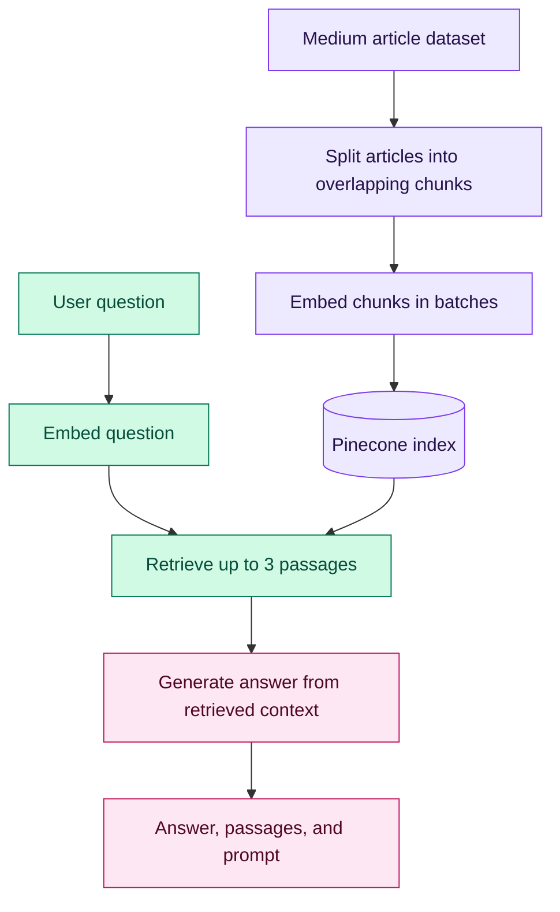

<div align="center">

# Medium RAG API

**Ask a question. See the Medium article passages behind the answer.**

A question-answering API that uses retrieval-augmented generation (RAG) over an indexed dataset of Medium articles.

[](https://medium-rag-api-lilac.vercel.app/docs)


[Try a question](#try-a-question) · [How it works](#how-it-works) · [Run locally](#run-locally)

</div>

## Try a question

In [Swagger UI](https://medium-rag-api-lilac.vercel.app/docs), expand **POST `/api/prompt`**, click **Try it out**, and send:

```json
{
  "question": "What is the best way to build a sustainable habit?"
}
```

The response lets you inspect the generated answer alongside the exact passages and prompt sent to the model.

| Field | What you get |
| --- | --- |
| `response` | The generated answer |
| `context` | The retrieved passages, with article IDs, titles, and similarity scores |
| `Augmented_prompt` | The system and user messages sent to the model |

[**GET `/api/stats`**](https://medium-rag-api-lilac.vercel.app/api/stats) returns the configured chunk size, overlap ratio, and retrieval depth.

## How it works



- **Indexing.** The [Jupyter notebook](Individual%20Assignment.ipynb) uses `tiktoken` to split article text into chunks of up to **500 tokens**, with **100 tokens** of overlap. It sends chunks in batches to LLMod.ai for embedding and stores vectors, passages, and article metadata in Pinecone.
- **Retrieval.** FastAPI embeds the question with the same model and queries the Pinecone index by cosine similarity for up to **three** passages.
- **Generation.** The API sends the retrieved passages and question to the chat model. The system prompt instructs the model to say when the passages lack enough information to answer.

The API uses the OpenAI Python SDK with **LLMod.ai’s OpenAI-compatible endpoint**. The configured models are `NBUECSE-text-embedding-3-small` for embeddings and `NBUECSE-gpt-5-mini` for generation.

## Run locally

To serve answers, you’ll need an LLMod.ai key with access to the configured models and a Pinecone key for a populated index named `medium-rag`. To build the index, supply your own copy of `medium-english-50mb.csv` with `title` and `text` columns, install `pandas` and `tiktoken` in your notebook environment, and run the notebook’s indexing cells with your credentials.

```bash
git clone https://github.com/liansigawi/medium-rag-api.git
cd medium-rag-api
python -m venv .venv
```

<details open>
<summary><strong>macOS / Linux</strong></summary>

```bash
source .venv/bin/activate
python -m pip install -r requirements.txt uvicorn
export LLMOD_API_KEY="your-llmod-api-key"
export PINECONE_API_KEY="your-pinecone-api-key"
python -m uvicorn api.index:app --reload
```

</details>

<details>
<summary><strong>Windows PowerShell</strong></summary>

```powershell
.\.venv\Scripts\Activate.ps1
python -m pip install -r requirements.txt uvicorn
$env:LLMOD_API_KEY = "your-llmod-api-key"
$env:PINECONE_API_KEY = "your-pinecone-api-key"
python -m uvicorn api.index:app --reload
```

</details>

Open [localhost:8000/docs](http://127.0.0.1:8000/docs) to try the local API.

## Project files

| File | Role |
| --- | --- |
| [`api/index.py`](api/index.py) | FastAPI endpoints, retrieval, and answer generation |
| [`Individual Assignment.ipynb`](Individual%20Assignment.ipynb) | Token-based chunking, batch indexing, and example queries |
| [`requirements.txt`](requirements.txt) | API dependencies |
| [`vercel.json`](vercel.json) | Routing for the Vercel deployment |
